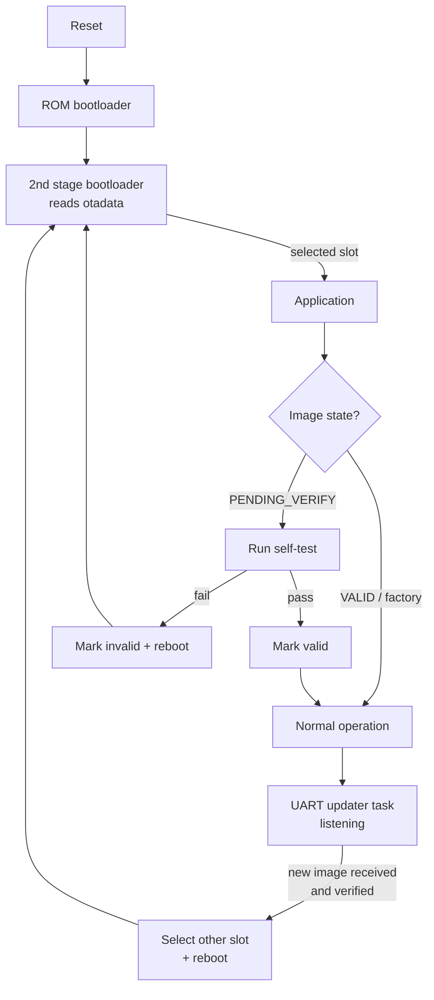

# ESP32 OTA Bootloader: fail-safe firmware updates


Firmware update system for the **ESP32** built with **ESP-IDF and FreeRTOS**. A new
application image is sent over **UART** from a PC, written to the inactive half of
an **A/B partition layout**, verified, and confirmed by a **post-update self-test**.
If the new firmware is broken, the device **rolls back automatically** to the
previous one.

The goal is the property every real product needs: **an update must never brick
the device**, even if the cable is pulled or the new code crashes.

## Features

- **A/B (dual-slot) updates** with a protected `factory` image
- **Custom binary protocol over UART**: framing, CRC16 per frame, ACK/NACK, retransmission, session timeout
- **End-to-end integrity**: CRC32 of the whole image, then the SHA-256 check done by ESP-IDF
- **Image validation before writing**: ESP32 image magic, chip ID and application descriptor
- **Automatic rollback** with a post-update self-test, plus the bootloader's own rollback if the app crashes before confirming
- **Rejects known-bad versions**: a version that was rolled back cannot be reinstalled by mistake
- **Python host tool** with progress bar and retries
- **Unit tests** for the protocol, in C (host) and Python, sharing the same reference frames

## How it works



### Flash layout (4 MB)

| Partition | Offset     | Size    | Role                                        |
|-----------|------------|---------|---------------------------------------------|
| nvs       | `0x009000` | 16 KB   | Non-volatile storage                        |
| otadata   | `0x00D000` | 8 KB    | Which slot to boot, and each image's state  |
| phy_init  | `0x00F000` | 4 KB    | RF calibration                              |
| factory   | `0x010000` | 1 MB    | Initial firmware, never overwritten by updates |
| ota_0     | `0x110000` | 1.25 MB | Slot A                                      |
| ota_1     | `0x250000` | 1.25 MB | Slot B                                      |

An update is always written to the slot that is **not** running. The boot slot is
only switched after the complete image has been received and verified.

### Update protocol

`SOF 0xA5 | CMD | LEN | PAYLOAD | CRC16`, stop-and-wait with ACK/NACK.
Full specification, sequence diagram and failure cases: [docs/protocol.md](docs/protocol.md).

## Hardware

- ESP32-WROOM-32 DevKit (4 MB flash)
- USB cable. By default, updates go through the DevKit's own USB port (UART0)
- Optional: LED on GPIO2 (built in on most "DevKit V1" boards)
- Optional: USB-serial adapter on UART1 (GPIO17 TX / GPIO16 RX) to keep logs and updates on separate ports

## Getting started

### 1. Build and flash the initial firmware

Requires [ESP-IDF v5.1](https://docs.espressif.com/projects/esp-idf/en/v5.1.4/esp32/get-started/).

```bash
cd firmware
idf.py set-target esp32
idf.py build
idf.py -p COM5 flash monitor
```

The device boots from `factory` and prints its partition, version and image state.

### 2. Build a new version

Change `firmware/version.txt` (for example `1.1.0`), and optionally the blink period
in `idf.py menuconfig` → *Demo Application*, then rebuild:

```bash
idf.py build
```

### 3. Send it over UART

Close the serial monitor first: the port can only be opened by one program.

```bash
pip install -r tools/requirements.txt
python tools/uart_flasher.py COM5 firmware/build/esp32_ota_bootloader.bin
```

Expected output (sizes and CRC depend on your build):

```text
Device: partition=factory version=1.0.0 state=factory
Image: <size> bytes, CRC32 0x<crc>
  [########################################] 100.0%  <size>/<size> B
Verifying image on device (CRC32 + SHA-256)...
Update written and selected for next boot.
Device is rebooting into the new firmware.
```

`python tools/uart_flasher.py COM5 --info` only shows which firmware is running.

## Demo: automatic rollback

1. Flash `1.0.0` with `idf.py flash`. It runs from `factory`.
2. Send `1.1.0` with the UART tool. It boots from `ota_0`, passes its self-test and is confirmed.
3. In `menuconfig`, enable *Demo Application → Simulate a broken firmware*, set the version to `1.2.0`, build and send it.
4. `1.2.0` boots from `ota_1`, **fails its self-test**, is marked invalid, and the device **reboots into `1.1.0`** on its own.
5. Trying to send `1.2.0` again is refused with `ERR_REJECTED`.

## Project structure

```text
esp32-ota-bootloader/
├── firmware/                     ESP-IDF project
│   ├── main/
│   │   ├── main.c                boot report, confirm or rollback, LED task
│   │   ├── uart_updater.c/.h     update session: receive, validate, write OTA slot
│   │   ├── self_test.c/.h        post-update health checks
│   │   └── Kconfig.projbuild     UART port/pins/baud, demo options
│   ├── components/fw_protocol/   framing + CRC, pure C99, unit-tested on PC
│   ├── partitions.csv
│   ├── sdkconfig.defaults        4 MB flash, custom partitions, rollback enabled
│   └── version.txt
├── tools/
│   ├── uart_flasher.py           host update tool (pyserial)
│   ├── fwp.py                    host protocol implementation
│   └── tests/                    Python unit tests
├── tests/host/                   C unit tests of fw_protocol (gcc)
├── docs/protocol.md
└── .github/workflows/ci.yml      firmware build + unit tests
```

## Tests

```bash
make -C tests/host test                        # C protocol tests (gcc)
python -m unittest discover -s tools/tests -v  # Python tool tests
```

The C and Python test suites check the same reference frames byte for byte, so
the firmware and the host tool always speak exactly the same protocol.
GitHub Actions runs both suites and builds the firmware with ESP-IDF v5.1.4 on every push.

## Roadmap

- [x] Custom partition table, A/B slots and factory image
- [x] UART update with framed protocol, CRC16/CRC32 and retransmission
- [x] Post-update self-test and automatic rollback
- [ ] OTA over Wi-Fi (HTTPS, `esp_https_ota`), with server certificate check
- [ ] Bootloader hook: hold the BOOT button at reset to start the `factory` image (recovery mode)
- [ ] Update triggered by an MQTT message
- [ ] Signed images (ECDSA), checked before switching slots

## Skills demonstrated

Embedded C, ESP-IDF, FreeRTOS tasks, UART driver, flash partitioning,
OTA/bootloader mechanisms, binary protocol design, CRC, fault tolerance,
Python tooling, unit testing, CI/CD.

## License

[MIT](LICENSE)
