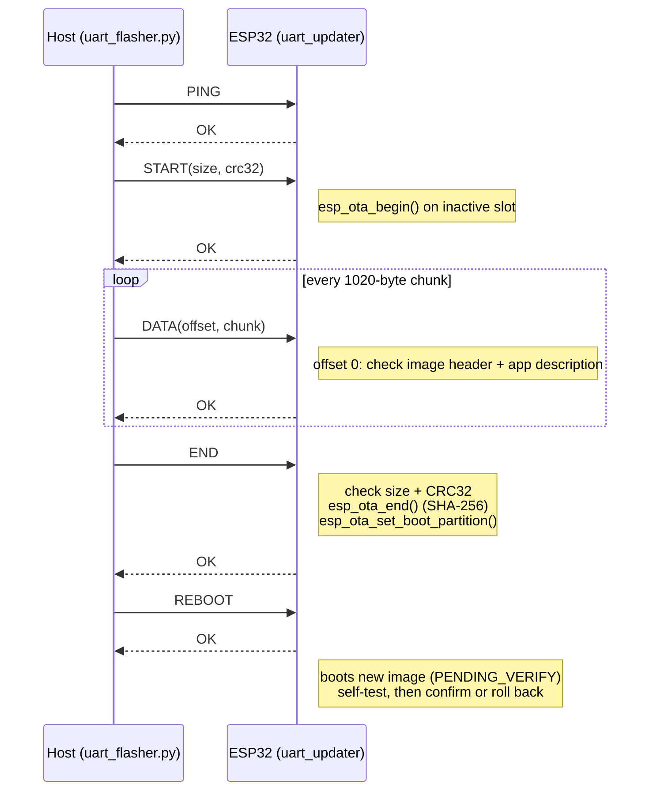

# UART update protocol

Stop-and-wait protocol: the host sends one frame and waits for the device's
response before sending the next one. Every frame is protected by a CRC16, and
the whole image by a CRC32 plus the SHA-256 that ESP-IDF checks in `esp_ota_end()`.

Implementations:
- Device: [`firmware/components/fw_protocol`](../firmware/components/fw_protocol) (C99, no ESP-IDF dependency)
- Host: [`tools/fwp.py`](../tools/fwp.py)

Both are tested against the same reference frames, so they cannot drift apart.

## Frame format

All multi-byte fields are little-endian.

| Field   | Size        | Description                                            |
|---------|-------------|--------------------------------------------------------|
| SOF     | 1 B         | `0xA5`                                                 |
| CMD     | 1 B         | Command (host) or `CMD \| 0x80` (device response)      |
| LEN     | 2 B         | Payload length, 0 to 1024                              |
| PAYLOAD | LEN bytes   | Command specific                                       |
| CRC16   | 2 B         | CRC-16/CCITT-FALSE over CMD + LEN + PAYLOAD            |

The parser ignores every byte until a SOF, so log text sharing the same UART
does not break the link.

## Commands

| CMD    | Code | Payload (host to device)                 | Response payload           |
|--------|------|------------------------------------------|----------------------------|
| PING   | 0x01 | none                                     | status                     |
| START  | 0x02 | `u32 image_size`, `u32 image_crc32`      | status                     |
| DATA   | 0x03 | `u32 offset`, then up to 1020 bytes      | status                     |
| END    | 0x04 | none                                     | status                     |
| REBOOT | 0x05 | none                                     | status, then device resets |
| INFO   | 0x06 | none                                     | status + ASCII text        |

If a frame cannot be parsed (bad CRC or length), the device answers with
CMD `0xFF` (NACK) and status `ERR_CRC`, and the host retransmits.

## Status codes

| Code | Name              | Meaning                                              |
|------|-------------------|------------------------------------------------------|
| 0x00 | OK                |                                                      |
| 0x01 | ERR_CRC           | Frame CRC16 or image CRC32 mismatch                  |
| 0x02 | ERR_STATE         | DATA/END received without a START                    |
| 0x03 | ERR_LEN           | Bad length, image larger than the OTA slot, image incomplete |
| 0x04 | ERR_OFFSET        | DATA offset is not the next expected one             |
| 0x05 | ERR_FLASH         | Flash erase/write failed                             |
| 0x06 | ERR_IMAGE         | Not an ESP32 application image, or SHA-256 check failed |
| 0x07 | ERR_UNKNOWN_CMD   |                                                      |
| 0x08 | ERR_REJECTED      | This version was rolled back before and is refused   |

## Sequence

## Error handling

| Situation                         | Behaviour                                                       |
|-----------------------------------|-----------------------------------------------------------------|
| Corrupted frame                   | NACK, host retransmits (up to 5 times)                          |
| Device ACK lost                   | Host resends the same DATA. The device sees it already has those bytes and acknowledges without rewriting them |
| Host stops sending for 10 s       | Session aborted, slot left unselected, running firmware intact  |
| Power loss during transfer        | Boot partition was never changed: old firmware boots            |
| Wrong file (not an ESP32 app)     | Rejected on the first chunk, before anything is written         |
| New firmware fails its self-test  | Marked invalid, automatic rollback to the previous firmware     |
| New firmware crashes before confirming | 2nd stage bootloader rolls back on the next boot           |
